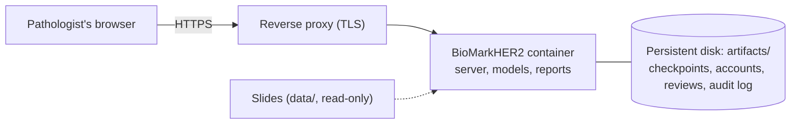

# Deployment note

**Where it can be deployed.** BioMarkHER2 fits **IaaS** best: one 4-vCPU, 8 GB virtual machine, for example an Amazon EC2
`t3.xlarge` or an Azure `D4s v5` instance in an Indian region, running the project with Docker Compose. It needs no GPU.
The system keeps accounts, the audit log and every signed review on disk (`artifacts/`), and the model files are mounted
at run time. IaaS gives full control of that persistent disk, the region and the HTTPS reverse proxy, and it keeps patient
images on a machine the hospital controls. The same container also runs unchanged on a hospital's own server.

**Other service models.** A **PaaS** container platform such as Google Cloud Run or Azure Container Apps could host a demo,
but its disks are not persistent by default, so accounts and reviews would need an extra managed volume. **SaaS** does not fit:
the project is a tool a hospital runs for itself, not a multi-tenant service with shared patient data.

**Docker.** Yes, the project is already packaged as a Docker container. The [`Dockerfile`](../Dockerfile) is multi-stage
(Node 22 builds the React portal, and `python:3.11-slim` runs the server), runs as a non-root user and has a health check.
[`docker-compose.yml`](../docker-compose.yml) starts it with one command, `docker compose up -d`, and the CI pipeline builds the
image on every push ([`CI_CD.md`](CI_CD.md)). Step-by-step instructions are in [`DEPLOYMENT.md`](DEPLOYMENT.md).

## How the pieces fit

The container is stateless apart from the mounted disk, so it can be rebuilt or replaced without losing accounts or signed reviews.
Patient images and every record stay on that disk, and nothing is sent to an outside service.

## Why not the other service models

| Model | Example platform | Disk that survives a restart | Control of where data sits | Fit |
|---|---|---|---|---|
| **IaaS** | Amazon EC2, Azure Virtual Machines | Yes, an attached volume | Full: region and machine are chosen | **Best fit** |
| PaaS | Google Cloud Run, Azure Container Apps | Not by default; needs an extra managed volume | Region only | Possible for a demo |
| SaaS | A hosted multi-tenant product | Not applicable | Provider decides | Does not fit: the hospital runs this tool for itself |
