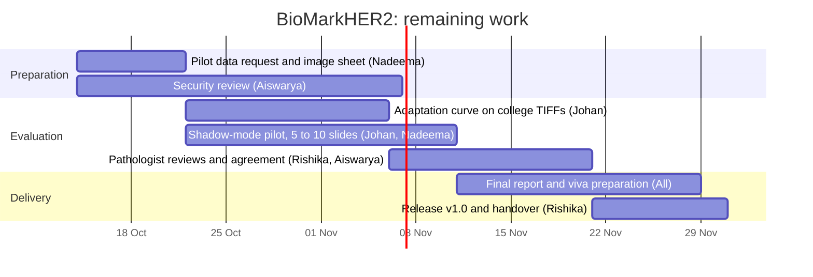

# Project plan: remaining work

This plan covers the work that is still open on BioMarkHER2. Each task is tracked as a GitHub issue, and the issues sit on the
Kanban board (To Do, In Progress, Done).

## Remaining tasks

| # | Task | Owner | Start | End | Issue |
|---|---|---|---|---|---|
| 1 | Pilot data request and image requirements sheet | Nadeema | 14 Oct | 21 Oct | [#6](../../../issues/6) |
| 2 | Security review before hospital deployment | Aiswarya | 14 Oct | 6 Nov | [#7](../../../issues/7) |
| 3 | Adaptation curve on the college's TIFF images | Johan | 22 Oct | 5 Nov | [#5](../../../issues/5) |
| 4 | Shadow-mode pilot on 5 to 10 slides | Johan, Nadeema | 22 Oct | 10 Nov | after task 1 |
| 5 | Real pathologist reviews and agreement analysis | Rishika, Aiswarya | 6 Nov | 20 Nov | after task 4 |
| 6 | Final report update and viva preparation | All | 11 Nov | 28 Nov | |
| 7 | Release v1.0: tagged Docker image and handover | Rishika | 21 Nov | 30 Nov | |

Tasks 3 and 4 wait for the college's slides (task 1). Task 5 needs the pilot slides from task 4, so it starts once the first
slides have been scored.

## Gantt chart

The same chart as text, which GitHub renders directly:

## Risk list

| ID | Risk | Type | Likelihood and impact | Mitigation |
|---|---|---|---|---|
| R1 | Accuracy falls at the college's scanner and stain. Measured accuracy was 40 to 55 % at hospitals the model was not trained on, against 92.3 % where it was trained. | Technical | High, high | The site safety gate hides the pre-score until the site is validated. Calibrate locally with at least 25 labelled cases. Run in shadow mode first, so no result reaches a patient. |
| R2 | The college's slides or a pathologist's time arrive late, which delays tasks 3, 4 and 5. | Schedule and external dependency | Medium, high | Send the request in the first week (task 1). Keep a one-week buffer before the report is due. Rehearse the pilot on public datasets in the meantime. |
| R3 | Patient data is exposed during the pilot. | Legal and security | Low, high | Process images only on the hospital's machine, with no upload to any cloud service. Use pseudonymised case identifiers, HTTPS and account lockout. Agree a short data-sharing note with the department before the pilot starts. |

## How the board is used

Every task above is a GitHub issue assigned to its owner and placed on the Kanban board in one of three columns:

- **To Do**: the issue is agreed but not started.
- **In Progress**: someone is working on it, usually with an open pull request.
- **Done**: the pull request is merged and the issue is closed.

A pull request that contains `Closes #<number>` closes its issue when it is merged, and the board moves the card to Done.
