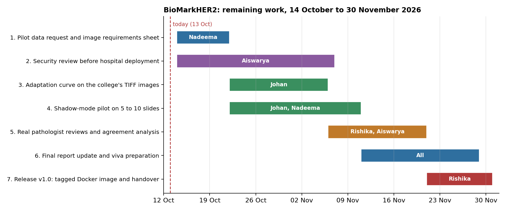
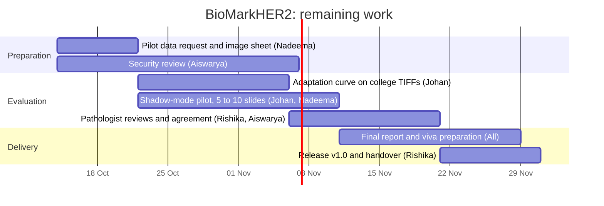

# Project plan: remaining work

This plan covers the work that is still open on BioMarkHER2. Each task is tracked as a GitHub issue, and the issues sit on the
Kanban board (To Do, In Progress, Done).

## Remaining tasks

| # | Task | Owner | Start | End | Issue |
|---|---|---|---|---|---|
| 1 | Pilot data request and image requirements sheet | Nadeema | 14 Oct | 21 Oct | [#6](../../../issues/6) |
| 2 | Security review before hospital deployment | Aiswarya | 14 Oct | 6 Nov | [#7](../../../issues/7) |
| 3 | Adaptation curve on the college's TIFF images | Johan | 22 Oct | 5 Nov | [#5](../../../issues/5) |
| 4 | Shadow-mode pilot on 5 to 10 slides | Johan, Nadeema | 22 Oct | 10 Nov | after task 1 |
| 5 | Real pathologist reviews and agreement analysis | Rishika, Aiswarya | 6 Nov | 20 Nov | after task 4 |
| 6 | Final report update and viva preparation | All | 11 Nov | 28 Nov | |
| 7 | Release v1.0: tagged Docker image and handover | Rishika | 21 Nov | 30 Nov | |

Tasks 3 and 4 wait for the college's slides (task 1). Task 5 needs the pilot slides from task 4, so it starts once the first
slides have been scored.

## Gantt chart

The same chart as text, which GitHub renders directly:

